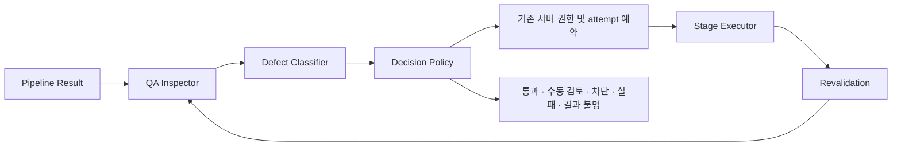

# MangoHana V2 Stage15 품질 오케스트레이터 및 멀티모델 계약 구현 계획

> Stage15 착수 시 Superpowers의 `executing-plans`와 변경 범위의 `test-driven-development`를 적용한다. 초기 Goal은 설계와 인계까지였으며, 구현 결과는 해당 슬라이스에 기록한다. 독립 검토는 프로젝트 역할 조건에 따라 선택한다.

**목표**는 검사 근거로 실패의 최초 단계와 영향을 받은 범위를 찾아, 승인된 동작만 수행하고 동일한 기준으로 재검증하는 것이다.  
**구조**는 기존 V2 실행기·승인·checkpoint 위의 순수 검사/판단 모듈과 기존 authority 아래의 단계 실행기로 나눈다. 운영 TypeScript 경로의 `ProviderAdapter`와 정산 의미를 확장에 재사용하되 현재 로컬 V2의 JSON 작업 저장소와 운영 PG 원장은 별개로 유지한다.  
**기술**은 프로젝트 Node 24와 기존 `.cjs`/`.mjs` 및 `node --test`를 첫 슬라이스에 사용한다. 운영 어댑터를 연결하는 작업은 현재 TypeScript/wire 계약·격리 PG18을 이용한다.  
**검증 기준**은 확인된 서명·현재 소스·로드맵이다. [Stage14-R3 종료](../../validation/2026-11-18-v2-stage14r3-human-readability-closeout.md) · [Stage00 보존 로드맵 원문](C:/dev/Projects/_audits/MangoHana_00_20261111_225834/roadmap-input-preserved.md:435) · [단계 구간](C:/dev/Projects/_audits/MangoHana_00_20261111_225834/roadmap-full-stage-sections.json)

**2026-11-18 KST · S15-01~06 합성 통합 검증 완료.** Node v24.22.1의 전체 V2 1323/1323(Stage15 전용 166건 포함), 격리 웹 233/233, 루트·사이트 타입 검사 종료 0을 확인했다. 정상 `/jobs`에서 승인된 대체는 최대 1회였고, `/batches`는 다른 페이지의 성공과 확정 부분합을 보존했다. 전체 회귀에서 발견한 E: 원자 예약과 같은 시도의 동시 조회 저장 실패를 고쳤다. [통합 검증 보고서](../../validation/2026-11-18-v2-stage15-integration.md) · [최종 집계·로그](../../validation/stage15-integration-20261118/verification.json)

S15-05가 해시한 PNG는 revision 12로 정정했다. 사용자 가독성 승인은 SHA-256 `76b665d1…cf71f3ba`인 revision 14 단일 페이지에 결속된다. 실제 두 페이지 시험에는 별도 실행 승인, 모델·자원 반환 계측과 공급자 정산 근거가 필요하다. 아래 착수 판단과 슬라이스별 집계는 각 시점의 기록이다. [승인·보존 대조와 실제 시험 조건](../../validation/2026-11-18-v2-stage15-integration.md)

## 현재 기준과 착수 판단

원래 다운로드 경로의 로드맵은 현재 접근할 수 없다. Stage00에 보존된 원문 SHA-256 `9bce6c06b77f484d0a62b3f30ebcb77f505c7cbc7d6240d31574ee7a2491dbbe`가 수집 manifest와 일치한다. 원문 435~449행의 단계15는 검사·오류 분류·결정·영향 단계 실행, 모델 공통 입출력, 실제 host/IPC/registry에서 fallback 호출 확인, 최대 1회와 품질·시간·비용 누적을 요구한다. 완료 근거는 adapter contract, fallback E2E, fault injection, DAG 검증이다. Stage14는 원문 416~434행으로 범위가 별개다. `docs/source-reference.json`의 OneDrive 원본은 현재 없고 저장소 보존 사본을 참조한다. [Stage00 수집 manifest](C:/dev/Projects/_audits/MangoHana_00_20261111_225834/roadmap-input-manifest.json) · [V2 진행 계획](2026-11-11-mangohana-v2-sites-integration.md) · [운영 계약 보존 사본](../../reference/trio-main/docs/superpowers/specs/2026-10-03-manga-web-contract-reference.md)

- **`READY_FOR_STAGE15_IMPLEMENTATION`** 범위는 S15-01 첫 합성 슬라이스다. Stage14-R3의 서명 성공·사용자 가독성 승인·남은 품질 범위를 검증했고 설계와 재개 조건을 고정했다.
- Stage15 전체의 실제 provider·다중 페이지 연동은 **`PARTIALLY_READY`**다. S15-04 이후에 실제 실행 권한, 동일 페이지 복구 및 비용 관측, 다중 페이지 자원과 취소 증거가 필요하다. 앱의 외부 허가·비용 설정은 아직 연결 승인 근거가 없다. 첫 슬라이스에 대한 전면 차단은 없다.
- 다음 세션은 최초 변경 전에 계획·Handoff를 읽고 HEAD·미커밋 범위·경계 코드·사용 가능한 Node runner를 확인한다. 소스 drift는 관련 경계만 재검증한다. 동일한 보호 파일의 무관한 전체 재검사나 실제 페이지 재실행을 선행 조건으로 두지 않는다. [Git 작업 상태](../../validation/2026-11-18-v2-stage14r3-git-handoff.md) · [최신 Handoff](../handoffs/2026-11-18-stage15-kickoff-readiness.md)

## 실제 호출 경로와 재사용 지점

| 경계 | 현재 확인한 호출 | Stage15 적용 지점 |
|---|---|---|
| 로컬 V2 일반 작업 | `scripts/v2/start.mjs` → `apps/engine/host.cjs`의 `createEngine`/`createJobStore`/`createEngineServer` → `apps/engine/store.mjs`의 `engine.run` → vendor `engine.cjs`의 `executeJob` | 처음에는 읽기 전용 QA 선택, 다음에 해당 composition에서 검사된 단계만 호출하는 명시적 연결. 일반 `engine.run` 반복 호출로 영향 단계 재실행을 구현하지 않는다. |
| R3 승인 전용 | `scripts/v2/review-start.mjs` → `translation-review-application.mjs` → `typesetting-only-controller.mjs`/`imported-page-controller.mjs` → `imported-page-runtime.mjs`의 고정 `typesetting-only-worker.cjs` → `typesetting-only-pipeline.cjs` | 별도 1회 상태와 `typesetting-resume-source.mjs`/`typesetting-layout-adapter.mjs`의 읽기 전용 provenance, 고정 no-model 격리를 회귀 대상에 둔다. 기존 이 경로의 권한으로 OCR/Gemma/LaMa/fallback을 실행할 수 없다. |
| OCR | 로컬 vendor `engine.cjs`의 `readOcrCheckpoint`, `validateExtraction`, `refineConnectedExtraction`, 품질 `ocr-checkpoint-compatibility.cjs`, `source-line-roi.cjs`. 운영 `packages/providers/src/local-ocr.ts`의 `dispatch`/`lookup` | OCR observer와 region ID/읽기 순서/좌표 검사만 공통화. 실제 양방향 어댑터를 연결할 때 모델 고유 범위와 원래 checkpoint 호환성 증명을 유지. |
| 번역 | 로컬 `engine.cjs`의 페이지 입력/응답 → `page-translation.cjs`의 `parsePageTranslationResponse`와 `translation-contract.cjs`, `translation-revision.cjs`. 운영 `TextStagesProvider`, `ProviderAdapter` | 최종 content JSON/ID 매핑·위험 힌트·사용자 확정문 보호를 재사용. 의미 경고를 변경 권한 또는 의미 정답으로 해석하지 않는다. |
| 마스크·복원 | 로컬 `mask-evidence.cjs`, `imported-image-contract.cjs`의 `verifyImportedMask`, `background-layout.cjs`, `imported-image-diagnostics.cjs`의 원자 진단. 운영 `LocalLaMaAdapter`와 `OperationalPipelineProvider` | MASK와 INPAINT 내부 경계를 분리하되 운영 wire의 `CLEANUP`에서 명시적으로 매핑. 보호 픽셀, alpha, source·mask·모델 지문 검증 전 결과를 소비하지 않는다. |
| 식자 | `imported-layout-background.cjs`의 실제 픽셀/ROI 검증, `verifyImportedLayout`, 한국어 H/S 표준, 승인 배치와 코드/폰트 SHA | HARD·SOFT를 진단과 행위 판단에 전달. 승인된 SOFT 코드·정확한 줄과 사용자 revision을 보존하며 결과 PNG 재열기·검증을 유지. |
| 내구·복구 | `recovery-checkpoint.cjs`의 `createCheckpointSession`·fingerprint, `recovery-policy.cjs`의 `classifyFailure`, `store.mjs`의 `atomicState` 및 새 사용자 retry, `image-permit-store.mjs` | 기존 저장 영역, exclusive 기록, 준비/소비·세대, ready marker·revalidation 재사용. 기존 일반 수동 retry 최대 횟수와 새 fallback 단일 예산은 별도이며 `RESULT_UNKNOWN`은 재조회부터 한다. |
| 운영 API/worker | `packages/domain/src/provider.ts`의 `StageInput`/`Observation`/`normalizeObservation` 및 `ExecutionService`, `packages/operations/src/pipeline-runtime.ts`의 준비된 리소스 경로 | 이미 구현한 `dispatch`/`lookup`, wire·비용·native 원장의 의미를 매핑한다. `startOperationalWorker`의 `RUNTIME_PIPELINE_UNIMPLEMENTED` 가드를 유지한 채 준비형 시험에서 증명한다. PG 원장을 로컬 큐에 복제하지 않는다. |

Desktop `inpaintingRegistry.ts`에는 `executeWithFallback`이 있고 확인된 호출은 기존 테스트·벤치마크다. 현재 로컬 V2의 `host.cjs`는 vendor `createEngine`을 사용하며 R3는 고정된 전용 worker를 사용한다. 해당 함수 존재만으로 두 경로의 실제 연결을 증명할 수 없다. S15-05는 향후 **정상 요청에서** host가 주입한 registry와 허가된 fallback의 `dispatch`/`lookup` 호출을 증명해야 한다. [로컬 host](../../../apps/engine/host.cjs) · [작업 저장소](../../../apps/engine/store.mjs) · [vendor 실행기](../../../packages/ai-engine/vendor/trio/scripts/sites-local/engine.cjs) · [전용 실행](../../../packages/ai-engine/quality/typesetting-only-pipeline.cjs) · [Desktop registry](../../../apps/desktop/src/main/inpainting/inpaintingRegistry.ts) · [운영 provider 계약](../../../packages/domain/src/provider.ts) · [운영 시작 경로](../../../packages/operations/src/runtime-startup.ts)

## 아키텍처 및 입력/출력 계약

아래 데이터는 계획의 타입 표기다. 구현은 로컬 V2에서 닫힌 내부 계약으로 시작하고 기존 wire/결과 응답 변경은 해당 슬라이스에서 호환성을 증명한다. 브라우저 명령은 파일 경로·모델 실행 인수·비밀·새 authority 증거를 제공하지 않는다. 코드 경계에서 빌드 태그 또는 HMAC가 필요한 경우 현재 모듈의 digest/검증기를 사용한다.

| 기록 | 필수 필드와 의미 |
|---|---|
| `StageBinding` | `ownerScope`, `projectId`, `pageId`, `pageNumber`, `requestId`, `generation`, `editRevision`, `contextRevision`, `layoutRevision`, `sourceSha256`, `inputDigest`, `mode`. 최초 승인이 있으면 `permitId`/proposal SHA/승인 이벤트와 각각 일치. 단계별 source refs에 normalized·mask·checkpoint·translation selection·layout plan·font/code/profile SHA 포함. 현재 단계가 수정할 수 있는 범위는 별도 명시. |
| `ArtifactRef` | `artifactId`, 생성 `stage`/`attemptId`, SHA·바이트·크기, storageRef(서버에서만 resolve), `kind` (`CANDIDATE`/`CHECKPOINT`/`VERIFIED`/`FINAL`), 부모 artifact/digest. 좌표 공간 `normalized_page_px` 또는 지정한 `normalized01`과 치수·변환 ID를 명시. 승인 ACK/marker 없이 candidate를 최종 결과에 사용하지 않는다. |
| `StageObservation` | `binding`, `stage`, `attemptId`, `provider`, `state` (`CONFIRMED_SUCCESS`/`CONFIRMED_NOT_STARTED`/`CONFIRMED_FAILURE`/`PARTIAL`/`CANCELLED`/`RESULT_UNKNOWN`), `requestRef`/`evidenceRefs`, `elapsedMs`, `usage`, `artifacts` 및 `regionIds`, `error` 또는 누락 ID. OCR은 고유 ID·허용 읽기 순서와 source-line lineage를 먼저 확정하고 하류 단계는 그 집합과 대응한다. |
| `QaFinding` / `Defect` | `stage`, `severity` (`HARD`/`SOFT`/`UNVERIFIED`), `code`, `pageId`, `regionId|null`, `artifactSha256`, 검사 이름·버전·측정·합격 기준/근거 refs, `inputDigest`. classifier는 `firstBadStage`, `affectedStages`, `retryEligibility`, `certainty`를 붙인다. 단계 근거가 없으면 최초 원인은 `null`이다. |
| `Decision` | `kind`, 기초 finding IDs, 의존 범위, 재검증할 검사 IDs, 필요한 authority 조건, 기존 artifact·승인 보존 요구, `countsAsDispatch`. 명시적인 `manualReview`, `retryWithinStage`, `fallback`의 차이를 유지한다. 판단 객체 자체에 실행 가능 토큰이나 provider client를 넣지 않는다. |
| `Attempt` | `attemptId`, `logicalStageKey`, `previousAttemptId`, `runAuthorityId`, `slot` (`PRIMARY`/`REEXECUTE`/`FALLBACK`), provider/pin, 시간, dispatch 확실성, outcome/receipt, 출력 위치·S/H 검사 결속. `logicalStageKey`는 owner/project/page·generation·revision·stage·inputDigest를 모두 포함한다. 복구는 같은 논리 키의 승인·소비·결과를 조회한다. |

| 구성요소 | 입력 → 출력 | 책임과 차단 | 재사용·검증 |
|---|---|---|---|
| QA Inspector | `StageObservation` + snapshot/검사 연결 → `QaFinding[]` | 기존 검사를 호출해 규칙·ID·좌표·픽셀·식자 evidence를 분리한다. 실제 PNG 없이 raster PASS를 만들 수 없다. 품질 추정이나 의미 경고는 독립 승인과 분리한다. parser 예외·자료 부재는 제한된 코드/미검증으로 표시한다. | `validateExtraction`, `parsePageTranslationResponse`, `verifyImportedMask`, `verifyRenderedBackgrounds`, `verifyImportedLayout`; 이미지 없이도 잘못된 ID/JSON/문자 테스트, 실제 픽셀 조건은 소유 합성 bytes. |
| Defect Classifier | 검사 findings + `StageObservation` + graph → `Defect[]`, 영향 범위 | 권한, 무결성, 품질, 확정 provider 실패, transport, partial, 결과 불명의 원인을 검사한다. 변경된 입력의 자손만 다시 검증한다. 최초 실패/영역을 알 수 없으면 재실행 범위 확대를 막고 review 한다. | `classifyFailure`, 기존 error code/region diagnostics, Stage04 provenance DAG 검증을 참조. 순서와 분리 오류가 재현되는 RED를 둔다. |
| Decision Policy | `Defect[]`, 현재 버전과 효과, user/permit authority, 시계·예산 → 정규화 `Decision` | 먼저 정책·무결성·권한 위반과 실행 불명을 처리한다. 같은 입력의 검사만 재평가할 수 있다. 실제 실행 판단도 executor의 서명/리비전/사용량 증명을 다시 거친다. | `recovery-policy.cjs`와 사용자 retry 가드의 분류를 재사용하며 정적 정책표 테스트. 기존 수동 retry 가능 표만으로 provider가 재실행 안전하다고 판단하지 않는다. |
| Stage Executor | 승인된 decision/immutable binding·attempt lease + registry 조회 → candidate observation | 새 attempt를 단 한 번 예약, owner/revision/permit/허용 범위·출력 경로·자원·비용 승인 및 abort 상태를 확인한다. 대기/권한 불일치에는 호출이 없다. executor는 스스로 새로운 Permit을 만들 수 없다. | `store`·controller/permit 원장·checkpoint·Windows Job lifecycle을 유지. 재시작, 병렬 요청, publish 직전 stale·cancel·쓰기 실패 fault injection. |
| Revalidation | 후보와 현재 authority·소스 → 검사 사실·검증된 artifact 또는 차단 | 같은 binding, 승인된 source/ROI/표준, payload SHA와 공급자 응답 ID를 대조한다. candidate 저장이 성공을 뜻하지 않는다. 보호 바이트·stage 후손 검사를 통과한 뒤 원자적 commit/영수증. 결과 불명은 조회/복원 기록으로만 해소한다. | `revalidate`, `verifyImportedOutput`, `writeExclusive`·ready 게시를 재사용. 출력 재열기·권한 변경 테스트와 손대지 않은 기존 PNG의 before/after 해시. |

### DAG와 범위

- 일반 `FULL_IMAGE`의 선행 관계는 `SOURCE → NORMALIZED → OCR → TRANSLATE`와 `OCR → MASK → INPAINT`다. 실제 삭제 범위가 승인 번역/역할 선택에 결속되면 `TRANSLATE → MASK` 의존도 기록한다. `TYPESET`은 승인된 번역·배치, INPAINT 및 폰트에 의존한다. 마지막 `VERIFY_FINAL → PUBLISH`에서 모든 영향 받은 부모 artifact SHA와 receipt가 현재인지 대조한다. 이미 확정된 원본/OCR/사용자 텍스트의 소유권은 각 노드에서 유지한다.
- `TYPESETTING_ONLY`는 signed OCR/번역·ROI·layout 및 `VERIFIED_CLEANED_INPUT`을 읽어 `TYPESET → VERIFY_FINAL → PUBLISH`를 수행한다. 그래프가 저장된 증거를 검증할 수는 있어도 해당 mode에 OCR/TRANSLATE/MASK/INPAINT 실행 노드를 생성하지 않는다. full fallback을 연결하지 않는다.
- 동일 소스 SHA라도 페이지/owner/리비전·마스크·언어·권한이 다르면 checkpoint를 바꿔 끼우지 않는다. 하류 예약은 부모 digest와 현재 당사자 동의에 묶는다. 잘못된 OCR ID로 후손이 실패하면 이전 정당한 결과를 보존하고 `OCR` 최초 원인을 추적한다. 기하 충돌만으로 OCR 재추론을 시작하지 않는다.
- 배치에는 페이지별 generation·fingerprint/잠금 및 하나의 명시된 배치 정책이 필요하다. 페이지 간 재사용은 오래된 context와 취소된 작업이 다른 페이지의 승인 상태에 합쳐지지 않게 검증한다. 실패 페이지의 lease를 반환하기 전에는 다음 자원을 선점하지 않는다. 완료 페이지를 그대로 두고 부분 실패만 보고한다.

### Provider Contract

공통 capability의 확장을 `ProviderAdapter.dispatch(StageInput, started, context)`, `lookup(executionId, input?)`, `normalizeObservation`의 의미와 맞춘다. 로컬 V2 경계에서 wire 이름이나 정산 구조를 복제하지 않는다. Registry는 server-owned `providerId`, `modelId`, `version`/binary+config digest, stage capability, `transport` (`SYNTHETIC`/`LOCAL`/`EXTERNAL`), `supportsLookup`, 식별 있는 취소, partial 형식, 입력 크기/언어/공급자별 deadline 및 권한 정책을 보관한다. 선언된 capability와 실제 응답이 다르면 dispatch 이전 또는 수신 검증에서 차단한다. [운영 어댑터](../../../packages/domain/src/provider.ts) · [운영 검사·관측 경계](../../../packages/domain/src/operational-pipeline.ts)

- **요청/응답 결속**은 stage 입력/출력 digest, page·lineage·좌표/region ID, 설정 및 source ref를 보유한다. OCR의 선 생성, 번역의 OCR ID 일치, 마스크/복원 픽셀 공간과 alpha 의미, 식자의 protected overlay를 각각 검사한다. partial은 수신 ID·누락 ID, 범위, 완료 여부를 모두 가진다. 확정된 부분만 격리하고 미확인 부분을 성공 텍스트로 채우지 않는다.
- **Confidence**는 `value|null`, `kind` (`DETECTOR_SCORE`/`OCR_SCORE`/`SEMANTIC_HEURISTIC`/`CALIBRATED`/`NOT_REPORTED`), `scale`, `calibrationRef|null`, `scope`를 함께 저장한다. 모델·단계·버전·calibration이 다른 score의 컷을 공통 확률처럼 비교하지 않는다. 규칙/HARD는 위험 추정과 독립이다. 사람 GT가 생기면 버전을 명시하고 표본·품질 기준을 별도로 검증한다.
- **오류**는 `INVALID_INPUT`, `INVALID_OUTPUT`(ID/JSON/shape), `QUALITY_BLOCKED`, `PROVIDER_UNAVAILABLE`, `TRANSPORT`, `TIMEOUT`, `PARTIAL`, `STALE`, `CANCELLED`, `RESULT_UNKNOWN` 등의 분류와 `phase` (`BEFORE_DISPATCH`/`DISPATCHED`/`PUBLISHING`), `started` (`true`/`false`/`null`), `retryability` (`NEVER`/`BEFORE_START_CONFIRMED`/`AFTER_REVIEW`/`LOOKUP_REQUIRED`)를 기록한다. `AbortSignal`·deadline은 전달하지만 요청 중 timeout만으로 공급자 미시작·멈춤·무비용을 추정하지 않는다.
- **시간과 비용**은 monotonic wall/stage latency, GPU/모델 시간, queue/wait 시간, tokens, `charge {state, amount, currency, source}`를 attempt ID별 누적한다. 단위와 측정 범위를 보존한다. 확정 금액만 decimal 또는 기존 정산 타입으로 계산하고 `UNCONFIRMED`가 있으면 총비용도 미확정과 확정 부분합으로 표시한다. 로컬 공급자 요금 0은 근거가 있는 경우만 기록하며 하드웨어 비용 미측정과 분리한다. 여러 영역에서 같은 page request ID를 중복 합산하지 않고 Codex 토큰·제품 모델 비용을 분리한다. [기존 로컬 합산](../../../apps/engine/store.mjs) · [운영 비용 타입](../../../packages/domain/src/full-stage-cost.ts)
- **모델 상태**는 기존 Gemma 4 E2B·관리형 OCR·LaMa·서명 폰트의 확인된 로컬 profile을 기본으로 참조한다. 처음부터 외부 모델 등록, 모델 다운로드 또는 현재 기본 모델 변경을 전제하지 않는다. [현재 모델과 자산 지문](../../validation/stage14r3-human-readability-closeout-20261118/evidence/current-verified.json)

### Decision Policy

| 재검증한 조건 | 판단 | 허용한 동작 |
|---|---|---|
| 출처·리비전·권한 정상, Hard 0, 필요한 품질 경고 승인 결속 | `PASS` | 해당 계약의 출력 게시로 진행. SOFT와 검토 상태 유지. 결과 게시 검증을 거친다. |
| 의미/가독성 경고 미검토, partial 또는 근거가 부족한 품질 | `MANUAL_REVIEW` | 정확한 영역·측정/미확정 사유를 제시. 후보 및 기존 결과 유지. |
| 자료는 같은 digest인데 검사 버전/보고 근거 재확인 필요 | `REVALIDATE_STAGE` | 보존 bytes/checkpoint에 출력 검사만 수행. 새 provider 호출 없음. |
| 허가된 정확한 단계·입력·기존 보호 조건 유지, 이전 시작/결과 확정, 사용자가 승인한 범위와 남은 예산 | `REEXECUTE_STAGE` | 해당 단계의 새 append-only attempt로 한 번 예약. 후손 재검증, 실제 작업에 별도 서버 실행권 확인. |
| 기본 provider가 확정적 실패 또는 시작 전 사용 불가, 검증된 후보·payload 범위·승인/비용/자원 맞음, 사용 가능 slot 1개 | `FALLBACK` | 동일 stage의 대체를 승인 범위 내 원자적으로 한 번 예약. 이미 청구된 확정 비용도 보존. 모드가 `TYPESETTING_ONLY`이면 해당 경로에서 금지한다. |
| stale·권한·출처 불일치, 비허용 mode, HARD 위반 또는 안전·capacity 근거 부족 | `BLOCKED` | publish/dispatch 금지, 원인과 영향 영역 기록. 이미 시작된 효과의 취소/결과 불명 처리를 별도 추적. |
| provider 또는 작업의 확정 실패, 허용된 복구 작업 없음 | `FAILED` | 실제 실패 증거 및 후보 보존. 확정된 비용과 상태 기록. |
| dispatch/응답·쓰기·정리·요금의 결과가 불명 | `RESULT_UNKNOWN` | 같은 attempt/evidence ID의 signed receipt/`lookup`/권한 상태 조회. fallback/retry 및 새 청구 금지, 건너뛰어 성공 처리 금지. |
| 취소 후 미시작 또는 종료 확인 | `CANCELLED` | 실행 중에는 승인 범위/lease 확인 후 정리. 취소 시 실제 효과가 불확실하면 `RESULT_UNKNOWN`으로 원인을 보존한다. |

Stage15의 기본안을 **명시적으로 승인된 하나의 실행 계보 전체에서 fallback 최대 1회**로 둔다. 단계마다 또는 process restart마다 예산을 리셋하지 않는다. 다중 페이지 요청은 배치의 상위 승인 한도를 별도로 검증하고 페이지 수만큼 예산을 암묵적으로 늘리지 않는다. 경쟁하는 두 executor 중 한 개만 durable slot 예약에 성공해야 한다. 예약 이후 응답 유실은 같은 시도 재조회로 처리한다. 인계 계획의 “1회”는 새로운 실행 승인으로 사용할 수 없다. 외부 전송은 사용자의 구체적 데이터 범위·대상과 비용 한도, 현재 운영 권한을 확인한 뒤 가능하다.

## 향후 구현 단위와 검증

S15-01 외 파일·경로는 이후 슬라이스를 위한 예상 위치다. 현재 목적에 필요한 작은 증거가 확보되면 기존 모듈에 해당 책임을 유지하고 파일 분할을 다시 검토한다. 먼저 새 결과가 하나 나오는 최소 단위로 시작해 별도 녹색 검증을 받는다. 표의 명령은 각 슬라이스의 검증 계획이다.

| ID와 목표 | 대상/기존 기능/선행 조건 | RED → GREEN / 통합 검증 | 위험·롤백 |
|---|---|---|---|
| **S15-01** 권한과 분리된 합성 정책 첫 슬라이스 | 새 `packages/ai-engine/quality/stage15-quality-decision.cjs`, `tests/v2/stage15-quality-decision.test.mjs`만. 기존 `recovery-policy.cjs`와 Stage04 ID/provenance 계약 참고. 현재 자료·Node 24 소스 확인으로 시작 가능. | 고정 합성 `assessStage({ binding, observed, findings, authority }) → Decision`에서 정상→PASS, 의미 경고→MANUAL_REVIEW, stale→BLOCKED, 전송 후 timeout→RESULT_UNKNOWN, 재검증→provider 호출 0의 최초 실패 테스트. 가장 작은 구현 후 `node --test tests/v2/stage15-quality-decision.test.mjs`로 all pass. fixture가 형식·scope를 바꿔도 fail closed인지 확인하고 기존 `node --test tests/v2/quality-policy.test.mjs` 통과. | Warnings나 unknown을 하나의 success로 합치는 위험. 이 두 파일만의 별도 patch 경계이며 기존 caller 변경을 제외한다. |
| **S15-02** 검사와 DAG, 최초 원인·영향 범위 | 새 `packages/ai-engine/quality/stage15-quality-inspection.cjs`, `stage15-stage-graph.cjs`와 `tests/v2/stage15-inspection-graph.test.mjs`. `page-translation.cjs`, `imported-image-contract.cjs`, `recovery-checkpoint.cjs`의 함수를 adapters로 사용. S15-01 계약 필요. | OCR 중복/누락/잘못된 계보 ID, 최종 content JSON 오류, 의미 경고, 마스크 한 픽셀 훼손, 식자 HARD·scope 침범, cycle/stale graph의 실패 테스트. GREEN에서 최초 노드와 page/region, 독립 영역 미변경·TYPESETTING_ONLY 무모델 그래프를 증명. `node --test tests/v2/stage15-inspection-graph.test.mjs tests/v2/imported-image-pipeline.test.mjs tests/v2/stage14r-page-response.test.mjs`. | 검사 순서 섞임·잘못된 부모 재사용. feature 호출 미등록으로 범위 제한, 기존 계약 검사 유지. |
| **S15-03** provider 입출력·비용 관측 | 새 `apps/engine/stage15-provider-adapter.mjs`, `tests/v2/stage15-provider-contract.test.mjs`; 기존 `ProviderAdapter`/`Observation`과 `usageFromReport`를 매핑. 합성 registry 두 개로 shape 검증, 설치 모델 profile 읽기만. S15-02의 일치 검증 필요. | 잘못된 ID/형식·partial·lookup 미지원·confidence scale 불일치·transport와 RPC timeout, cost null·중복 evidence ID로 실패 관측. GREEN에서 raw provider 사실과 stage QA를 구분, 기본·대체 latency/cost 합산, 0/미확정·부분합 분리. `node --test tests/v2/stage15-provider-contract.test.mjs tests/v2/batches.test.mjs`. | 운영 wire/schema의 조용한 호환성 손실. 기존 타입 변경은 해당 프로파일에서 별도 계약 검증하고 로컬 매핑을 제거 가능하게 둔다. |
| **S15-04** 한 번 예약과 재검증 실행기 | 새 `apps/engine/stage15-attempt-executor.mjs`, `tests/v2/stage15-attempt-executor.test.mjs`; 필요 부분만 `store.mjs`의 immutable state·`image-permit-store.mjs` exclusive write·`recovery-checkpoint.cjs` 재사용. 승인 스코프와 `RESULT_UNKNOWN` 복구 상태 확정 필요. 최초 합성 epoch 및 fail-closed 기본. | 동시에 두 개 예약, timeout의 결과 불명, 취소 후 늦은 응답, stale 변경, atomic commit 실패·crash, 같은 요청 재시도에서 다시 dispatch되는 RED. GREEN에서 1 slot, stable reserve/post-crash lookup, 틀린 owner·mode 호출 0, 기존 출력 hash 그대로. `node --test tests/v2/stage15-attempt-executor.test.mjs tests/v2/imported-page-execution.test.mjs tests/v2/batch-recovery.test.mjs`. | dispatch-commit 사이 race로 중복 사용·비용 발생. 미확정 record 보존, 등록 비활성화로 롤백, 소비/시도 원장은 되돌리지 않는다. |
| **S15-05** 실제 host/registry 연결과 fallback E2E | `apps/engine/host.cjs`, `apps/engine/store.mjs`, `packages/ai-engine/vendor/trio/scripts/sites-local/engine.cjs`의 기존 단계 호출점과 S15-04. 새 `tests/v2/stage15-fallback-e2e.test.mjs`. `server.mjs`의 기존 정상 `/jobs` 처리에서 연결. 운영 `pipeline-runtime.ts`는 준비된 worker/map을 별도 검증할 때만. 선행 S15-03/04, resource ownership·provider/path/cost 승인 설계 완료. | 정상 host composition의 loopback 합성 요청으로 registry 연결 이전에는 대체 관찰 불가를 RED로 기록. GREEN은 `createEngineServer`→store/host의 선택→primary 확정 장애→허가된 alternate 1회→같은 stage QA/revalidation·서명 출처 확인. source/head drift, 실제 provider 권한 없음, TYPESETTING_ONLY의 fallback 포트 없음, unknown·취소에는 대체 0. 테스트는 실제 모델/외부 접근 0. `node --test tests/v2/stage15-fallback-e2e.test.mjs tests/v2/typesetting-only-native.test.mjs`. | Desktop 테스트가 연결 근거처럼 사용될 위험과 운영 부팅 가드 우회. 직접 import만으로 완료 표시하지 않는다. host opt-in을 되돌리고 기존 큐/전용 controller 경계를 유지한다. |
| **S15-06** 배치 격리·비용/시간 누적 및 후속 통합 | `apps/engine/store.mjs` 배치/취소/복구, 기존 `apps/sites/checks/batch-*`, 새 `tests/v2/stage15-batch-accounting.test.mjs`. 별도 운영 시험에서는 `ExecutionService`/정산·`ProviderAdapter` 경계 재사용. S15-04/05, 다중 페이지 자원·취소·보호 근거와 외부 또는 실제 모델의 별도 승인 필요. | 페이지 A 성공/B timeout에서 A 불변, B의 결과 불명 유지, 교차 owner/context rejection, 멱등 요청, 배치·페이지 한도 경합, 공유 번역 request 중복 비용/시간 오류로 RED. GREEN에서 고정 합성 clock/usage로 확정 합과 미확정 분리, 실제 승인 경로에서 재현할 fault/E2E 계획 및 잔여 조건 확인. `node --test tests/v2/stage15-batch-accounting.test.mjs tests/v2/batches.test.mjs tests/v2/batch-http.test.mjs`. | 배치 전체 재실행·spill·정산 과장 위험. 신규 배치 정책 등록을 끄고 immutable 완료 원장·예산·부분 결과 보존. |

S15-01의 소규모 실행 순서

- [x] Node 24에서 위의 계획된 두 파일이 존재하는지, 담당 기존 branch/HEAD·관련 소스 drift를 확인하고 사용자에게 현재 적용 범위를 짧게 남긴다. 이미 같은 기능이 생겼으면 소스/검사 재사용 여부부터 좁게 판단한다.
- [x] 첫 테스트 파일에 고정 owner/page/revision/hash의 합성 데이터, `decision.kind`의 예상값, 정책 호출이 파일/서버/provider capability를 받지 않는지 확인을 추가한다. 구조가 달라 최소 테스트 실행이 안 되는 경우도 원인으로 기록한다.
- [x] `node --test tests/v2/stage15-quality-decision.test.mjs`의 RED 값을 보존한다. 정책을 순수 함수 한 개로 시작하고 기존 모드에는 기본 권한을 부여하지 않는다.
- [x] 같은 테스트 GREEN과 `node --test tests/v2/quality-policy.test.mjs`를 확인한다. 코드/실패와 성공의 source hash, 입력 범위, provider/PNG/Permit 0을 기존 플랜과 validation에 남긴다. 이 시점에 다음 슬라이스를 자동 시작하지 않는다.

**2026-11-18 KST · S15-01 구현과 집중 검증 완료.** Node 24.22.1에서 모듈 부재 RED와 합성 동작 RED 17건, 관측값 모순 RED 2건을 확인했다. 최종 집중 21/21과 기존 정책 회귀 38/38이 통과했다. 실제 모델·dispatch·Permit·PNG 생성은 0회다. S15-02는 현재 artifact와 결속된 필수 검사 목록, 검사 상태·버전·근거 ID, 같은 근거를 참조하는 finding을 공급하는 작업으로 이어진다. [입출력 계약·판단 우선순위·검사 증거](../../validation/2026-11-18-v2-stage15-quality-decision.md)

**2026-11-18 KST · S15-02 구현과 집중 검증 완료.** 검사기가 현재 리비전·산출물 바이트·입력·부모 산출물에 결속된 근거를 S15-01 형식으로 반환한다. DAG는 최초 확인된 HARD 결함과 연결된 후손을 페이지·영역 단위로 계산하며, 상위 근거가 미검증이거나 독립 원인 후보가 여럿이면 하나의 최초 원인을 확정하지 않는다. Node 24.22.1에서 모듈 부재 RED, 동작 RED 18건, 결속·최초 원인 판정 RED 4건을 확인했다. 최종 집중 22/22와 지정 회귀 28/28이 통과했다. 실제 dispatch·모델 호출·Permit 발급·PNG 생성은 0회다. S15-03은 후속 계획으로 남긴다. [검사·DAG 계약과 근거](../../validation/2026-11-18-v2-stage15-inspection-graph.md)

**2026-11-18 KST · S15-03 구현과 집중 검증 완료.** 합성 provider 2종의 입력·응답, 부분 성공, 전송 전후 timeout, 동일 시도 lookup과 정산 관측을 구현했다. 시간과 USD를 동일 단계 입력의 시도별로 합산하고 사용량·근거가 미확정이면 총액을 `null`로 보존한다. Node 24.22.1에서 모듈 부재 RED와 경계 RED 4건을 확인했다. 최종 집중 22/22와 OS 임시 경로·기존 PNG 바이트를 사용한 지정 배치 회귀 17/17이 통과했다. 실제 dispatch·모델·Permit·최종 PNG 생성 및 PNG 인코딩은 0회다. S15-04는 후속 계획으로 남긴다. [provider 계약과 검증 기록](../../validation/2026-11-18-v2-stage15-provider-contract.md)

**2026-11-18 KST · S15-04 합성 구현과 지정 검증 완료.** 허가된 요청·provider 지문과 소비 슬롯을 같은 디스크 기록에 결속했다. 독립 Node 프로세스의 경쟁, 세 중단 경계에서 같은 시도 조회, 시작 확인 보존, 취소·현재 권한 변경과 재검증 후 원자 게시를 시험했다. Node v24.22.1 집중 38/38, 기존 실행·복구 회귀 38/38, 변경 영향을 받은 S15-02와 S15-03 집중 검사가 각각 22/22 통과했다. S15-04 최종 집중 실행에서 합성 dispatch 38회, lookup 포트 10회, 대체 provider dispatch 0회였다. 실제 제품 모델 호출·사용자 Permit·사용자 최종 PNG 생성은 각각 0회다. S15-05·06은 미착수다. [실행기와 검증 증거](../../validation/2026-11-18-v2-stage15-attempt-executor.md)

S15-03의 기존 22/22는 provider 집중 검사이고 17/17은 임시 로더를 사용한 격리 배치 회귀다. 당시 성공 명령·로더와 합쳐진 출력을 회수했다. 이번 별도 재현 17/17에서는 합성 PNG 정규화 인코딩을 유지했다. 두 배치 실행 모두 원래 fixture·E: 조건은 미실시다. [S15-03 증거 보완](../../validation/stage15-04-20261118/s15-03/evidence-summary.md)

**2026-11-18 KST · S15-05 단일 페이지 합성 host 연결과 집중 검증 완료.** 정상 loopback `POST /jobs`에서 host가 구성한 저장소와 vendor 번역 단계를 거쳐 기본 provider 확정 실패 후 승인된 대체가 1회 실행됐다. 동시 중복 요청과 host 재개방에서 소비한 슬롯을 보존했다. 결과·정산 미확정, 취소, 세대·문맥·원본·실행 버전 변경에서는 대체 호출이 0회였다. 대체 응답 유실은 같은 실행 ID로 조회했고, 기존 번역 검사 및 현재 승인과 일치하는 서명 근거로 결과를 게시했다. Node v24.22.1 지정 검사 46/46, 영향 회귀 66/66 및 기존 vendor 경로 3/3 통과. 실제 제품 모델·사용자 Permit·사용자 최종 PNG 생성은 각 0회다. S15-06은 미착수다. [검증 보고서](../../validation/2026-11-18-v2-stage15-fallback-e2e.md) · [실행별 기록](../../validation/stage15-05-20261118/verification.json)

**2026-11-18 KST · S15-06 정상 배치 합성 연결과 집중 검증 완료.** `POST /batches`에서 A의 성공 결과와 파일 해시를 보존하면서 B의 결과 미확정·시작 전후 취소를 페이지별로 기록했다. 공유 번역과 동일 시도 조회는 모델 시간·정산을 한 번만 합산했고, 미확정 금액은 총액 `null`과 확정 부분합으로 표시했다. 원장의 원자 예약으로 페이지·배치 한도와 배치 대체 1회를 적용했다. Node v24.22.1에서 지정 검사 40/40, S15-03~05·배치 복구 회귀 110/110, Studio·프록시 28/28이 통과했다. revision 14 승인 영수증의 최종 PNG 및 보호 파일 18개 해시가 일치했다. 실제 제품 모델·사용자 Permit·사용자 최종 PNG 생성은 각 0회다. 별도 승인 후 수행할 실제 두 페이지 장애·정산 시험과 현재 보장 범위는 검증 보고서에 기록했다. [검증 보고서](../../validation/2026-11-18-v2-stage15-batch-accounting.md) · [실행별 증거](../../validation/stage15-06-20261118/verification.json)

### 테스트 완료 매핑

|사례|슬라이스와 관찰 결과|
|---|---|
|정상 파이프라인|01·05 PASS/정확한 stage·검증/소유서명, 실제 경로 연결 근거 별도 표시|
|오류 주입|02·04·05 parser/revision/자원/atomic commit/정리와 예외 상태 검증|
|잘못된 OCR region ID|02 중복·누락·다른 lineage 및 하류 번역·좌표 결속 거부|
|번역 JSON 형식 오류|02 최종 content/스키마·region 대응 확인과 깨진 JSON 차단|
|의미 경고|01·02 사용자 확인 대기, 사용자 문장·독립 의미 상태 유지|
|마스크·인페인팅 품질 실패|02 보호 픽셀·alpha/출처의 실패가 HARD, 파일 보존|
|식자 HARD 위반|02 글리프·어절·줄·bbox·겹침, 기존 승인 임의 완화 금지|
|Provider timeout|01·03·04 dispatch 전과 후를 구분, 후자는 조회 우선|
|네트워크 오류|03·05 전송 불명, 권한·비용·payload 실패면 호출/대체 0|
|부분 성공|03·06 missing region ids 보존, 페이지/단계 완료 false|
|stale revision|01·04·06 승인취소·A/B revision 바꿈·늦은 worker 결과의 publish 차단|
|취소|04·06 늦은 결과와 부분 artifact 냉각, 시작/정리 불명 별도 확인|
|RESULT_UNKNOWN|01·04·05 동일 attempt 조회, 신규 호출/비용·실행 재분류 방지|
|fallback 1회 제한|04·05·06 double dispatch/restart/다중 페이지에서 ledger slot 한 개|
|비용 및 시간 누적|03·06 같은 ID는 1회, 두 시도의 확정합·미확정·queue/GPU 구분|
|원본과 정상 산출물 보존|02·04·06 후보별 경로, PNG/원본/승인 digest 불변, temp/lock 정리|
|반복 실행 중복 방지|04·06 같은 idempotency key/서명·generation은 조회, 다른 payload는 conflict|

코드를 실제 연결한 슬라이스는 집중 테스트 외에 기존 `npm run test:v2`, 웹 격리 runner `node scripts/v2/test-web-isolated.mjs <이번 증거 디렉터리>`, 루트 `node node_modules/typescript/bin/tsc --noEmit --incremental false`, 사이트 `node apps/sites/node_modules/typescript/bin/tsc --project apps/sites/tsconfig.json --noEmit --incremental false`를 해당 변경 범위 끝에서 실행한다. 네 명령의 실제 결과·경합/실패 로그·검사 전후 SHA를 남긴다. 시험 경로가 실 모델이나 실제 사용자 dataRoot를 부를 수 있으면 격리를 먼저 검증한다. 최초 계획 작성 때는 기존 결과의 범위를 확인했다. 이번 통합 실행은 동일 계획 아래 별도 기록으로 남겼다. [통합 검증 기록](../../validation/2026-11-18-v2-stage15-integration.md)

## Stage14 미완료 항목의 선후 관계

| 항목 | 관계 | 근거와 필요한 증거 |
|---|---|---|
| Stage15 설계의 기반 | 설계 전 확인 완료 | 공식 roadmap, owner/revision·서명 결과, 현재 실제 호출 경로의 구분, R3의 정확한 단일 페이지 증거. 아래 미완료 항목들이 합성 정책 설계를 차단하지 않는다. |
| 서로 다른 실제 페이지 2개 | 특정 S15-06 실제 다중 페이지 전 | 같은 source digest 또는 반복한 동일 페이지가 다른 page/context/cost 격리를 입증하지 않는다. 실제 두 페이지의 해시, 읽기순서, 동시성/자원/취소·기존 출력 보존. |
| 여러 장 연속 처리 | 후속 통합 테스트에서 확인 | 2장 증거 뒤 기존 queue/revision/우선순위, 부분 실패 consumer와 취소 후 늦은 이벤트 검증. 첫 슬라이스는 두 synthetic page ID로 재현. |
| ZIP 내보내기와 파일 정책 | 후속 통합 테스트에서 확인 | 기존 `uploads`/결과 export 정책(8MiB JPG/PNG/WebP, ZIP 경계)을 적용해 완료/실패 항목과 해시를 대조. Stage15 QA 규칙보다 export 표면의 별도 책임. |
| 실제 브라우저 업로드·다운로드·복원 | 후속 통합 테스트에서 확인 | R3 Chrome은 기존 1장 권한·실행 조회를 증명했다. 브라우저의 reimport, 읽기 위치/zoom/scroll, batch ID와 늦은 event가 새 실제 흐름에서 확인되어야 한다. |
| 모델 lifecycle·리소스 피크 | 특정 S15-05 실제 enable 및 S15-06 전 | Stage14의 단일 Windows Job 정리·자원 기준과 실제 다중 native/model lifecycle은 증거 범위가 다르다. 현재 안전 여유와 시간/peak/순차 해제 계측 없이는 두 provider/페이지를 함께 활성화할 수 없다. |
| 실제 모델/작업 장애 복구 | 특정 S15-04/05 실제 enable 전 | 합성 crash로 계약을 시험할 수 있다. 실제 시작/미시작/결과 불명/종료와 비용 조회 키의 내구성 없이는 운영 fallback·복구를 켜지 않는다. |
| export/reimport 추가 AI 0 및 bytes | 후속 통합 테스트에서 확인 | round-trip 원본/PNG/TRIO/상태와 refs 재생성 시 기존 출처 검증. checkpoint 해시가 같은 것만으로 브라우저 추가 호출 0을 입증할 수 없다. |
| 사람 GT·독립 번역 의미·마스크 내부 작화/잔상 | Stage15와 병행 가능한 검증 | 실제 페이지의 가독성 승인은 한 장의 승인이다. 별도 reviewer/GT, 신뢰 계수 보정과 임계값·모델별 정확도 평가는 품질 정책의 실증 전 필요하고 소프트웨어 계약/합성 검증은 병행 가능하다. |

다중 페이지에서는 같은 OCR 번호나 `requestId`가 서로 다른 페이지에 있을 수 있다. 현재 queue 소유권·페이지 scope를 넘어 최종 PNG나 비용이 공유되지 않도록 generation, owner와 정산 event를 포함해 키를 정한다. 독립된 페이지의 승인을 완료 페이지에 덮어쓰지 않는다. 이 설계의 2페이지 합성 테스트가 실제 Stage14의 2페이지 제품 완주를 대신하지 않는다.
